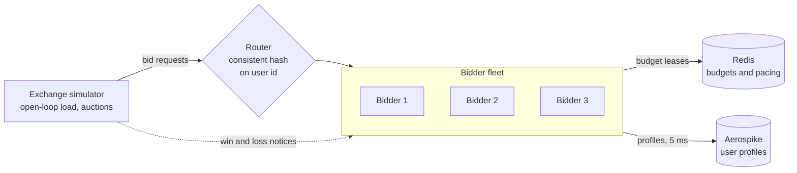
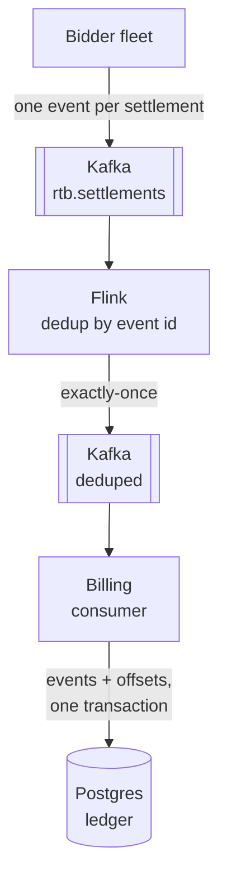

# rtb-platform


A real-time bidding (RTB) platform in Java 21: a low-latency bidder that answers OpenRTB bid requests in about 0.1 ms, enforces campaign budgets across a fleet with Redis-backed leasing, caps ad frequency per user, looks up audience profiles in Aerospike under a strict deadline, and stays correct when its dependencies fail or traffic exceeds capacity. Every auction outcome flows through an exactly-once pipeline (Kafka, Flink, Postgres) into a billing ledger that reconciles with the bidder to the micro. An in-process ONNX click model prices each impression by its expected value. Every claim below comes from a measurement in this repo.

## Highlights

| Area | Result |
|---|---|
| Bidder latency | p50 **0.10 ms** at 5,000 QPS, unchanged after adding targeting, budgets, frequency caps, and async profile lookups |
| Budget leasing | **About 1 Redis call per 320 bids** (99.7% fewer than a call per bid), with zero hot-path latency cost |
| Fleet budget correctness | 3 bidder instances, $40.50 leased: **$0.00 overspend**, ledger reconciled to the micro |
| Frequency caps across a fleet | Round-robin routing: **433 users over cap** (up to 3x). Consistent-hash routing: **0** |
| Database hang (Aerospike frozen) | Circuit breaker skipped **19,000+ lookups**, recovered on the first probe, **0 exchange errors** across 90,000 requests |
| 50% overload | Without shedding: **0 of 45,000** requests answered in time. With deadline-aware shedding: **all 45,000**, p99 **26 ms** |
| Exactly-once settlement | **470 retried win/loss notices** ignored; bidder and exchange agreed on 5,032 wins and $6.15 of spend to the micro |
| Bid shading, measured | Against a simulated market: **40% lower spend** and **29% lower cost per win**, for 17% fewer wins |
| Flink deduplication | **500 replayed duplicates in, 0 out**; output stayed at exactly 6,425 unique events |
| Billing ledger | After a **SIGKILL of the billing consumer** mid-stream: 12,143 settlements, 6,488 wins, 7,959,567 micros, **identical** to the bidder |
| Reconciliation caught a real bug | Cross-system totals exposed **6,361 settlements silently dropped** by an event ID collision; fixed with bidder-generated IDs |
| CTR model | Gradient-boosted trees closed **93% of the gap** to the best possible log loss; logistic regression only 38%, because ad relevance is a feature interaction |
| Expected-value bidding | **26 µs** inference per request, **87%** prediction-cache hit rate, no added median latency; per-campaign normalization cut cost per click below fixed prices, while a global baseline **overpaid by 22%** |
| Tests | **200 tests**, including a golden-file test that Java reproduces Python's model predictions, Testcontainers suites against real Redis, Aerospike, Kafka, and Postgres, and chaos tests that freeze, kill, or crash components mid-traffic on every CI run |

## Architecture

**Bidding path:** the exchange sends bid requests through a router to a fleet of bidders, which consult Redis and Aerospike under strict deadlines.



**Settlement pipeline:** every auction outcome becomes exactly one event, which is deduplicated and billed exactly once.



Inside one bidder, a request flows through layers that each own one concern:

```text
Netty event loop (HTTP, TCP_NODELAY, keep-alive)
  -> AdmissionController   bounded worker pool, sheds requests that cannot meet the deadline
  -> BidPipeline           profile lookup with a 5 ms deadline and a circuit breaker
  -> TargetingBidEngine    pure, no I/O: targeting, frequency caps, pricing, budget
```

The engine does no I/O at all ("functional core, imperative shell"), so the decision logic is fast and trivially testable, and every timeout, failure, and fallback lives in one thin async layer.

After the auction, every bid's budget reservation settles exactly once:

```text
bid ──reserve──> PENDING ──win notice──> charge the clearing price, release the rest ──┐
                    │──── loss notice ──> release everything ─────────────────────────┼──> one event to Kafka
                    └─ no notice in 60s ─> release everything (assume lost) ──────────┘
```

## Key design decisions

### Bidding

**Bitset inverted index for targeting.** Each targeting value (ad size, country, site category, audience segment) maps to a bitset of campaigns. Matching is a bitwise AND across dimensions, 64 campaigns per CPU instruction. The index is immutable after construction, so every event loop thread reads it with no locks.

**Budget leasing instead of a Redis call per bid.** Each bidder leases chunks of a campaign's daily budget from Redis and spends them locally with lock-free compare-and-swap. A refill starts at a low-water mark (20% of a chunk), single-flight per campaign, so it usually lands before the lease runs dry. Redis round trips measured 1.56 ms on average (248 ms worst case) locally, which would have dominated a 0.10 ms bid path.

**Atomic Lua script for leasing and pacing.** Reading the remaining budget, granting a partial amount, and recording the spend run as one atomic Redis script, so concurrent bidders can never drive a budget negative. The same script enforces even pacing (`allowed = total x elapsed share of day + burst`), which makes pacing global across all instances with no extra coordination. Budgets are keyed by UTC date and reset daily without a cron job.

**Consistent hashing for user affinity.** Frequency caps live in each bidder's memory (exact sliding windows, bounded by a Caffeine cache). That is only correct if each user always reaches the same bidder, so the router uses a consistent hash ring with 200 virtual nodes per instance. Adding a fourth instance moves about 25% of users, all onto the new instance; modulo hashing would move about 75%.

### Resilience

**Deadlines everywhere.** Every network call has a timeout matched to how long its result is useful: 5 ms for profile lookups (the Aerospike client gets 7 ms so the pipeline deadline is the single source of truth), 1 s for Redis refills (instead of Lettuce's 60 s default, which would hold a refill slot for a minute after a Redis blip), and 10 ms for Kafka sends so a broker problem can never block a bidder thread.

**Circuit breaker.** Lookups are counted over a 1-second window. At 50% failures (minimum 20 calls) the breaker opens and requests skip the lookup entirely; after 2 seconds a single probe tests recovery. The CLOSED path is a lock-free volatile read.

**Deadline-aware load shedding.** Bid work runs on a bounded worker pool, not the I/O threads. A request that waited longer than 20 ms in the queue is dropped before any work is done, because its answer would likely miss the exchange deadline. This prevents congestion collapse, where a server spends all its capacity on requests whose callers already gave up.

### Settlement and billing

**Exactly-once settlement in the bidder.** Exchanges retry notices, so a naive bidder double-charges on every retry. Settlement starts with an atomic remove of the pending reservation: the first notice settles it, and duplicates find nothing. Wins charge the clearing price (never more than reserved) and release the rest; reservations with no notice expire after 60 seconds and are released, which also recovers bids whose responses reached the exchange too late to be auctioned.

**Bidder-generated event identity.** Every settlement becomes exactly one event whose ID derives from the bid ID, so any re-send carries the same ID and can be deduplicated downstream. Bid IDs are generated by the bidder (`b-<random 64-bit process id>-<counter>`), never borrowed from the exchange: request IDs are only unique within one exchange's traffic, and deriving identity from them caused real settlements to be dropped as duplicates (see below).

**Exactly-once as layers, not one switch.**

| Layer | Prevents |
|---|---|
| Atomic remove of the pending reservation | Duplicate notices settling twice |
| Kafka producer idempotence (`acks=all`) | Network retries writing an event twice |
| Flink keyed state with a 24-hour TTL | Re-sent or replayed events reaching billing |
| Flink transactional sink plus `read_committed` consumers | Output from a Flink crash being exposed or written twice |
| Kafka offsets stored in Postgres, in the same transaction as the events | The billing consumer double-billing or skipping after a crash |
| `PRIMARY KEY (event_id)` with `ON CONFLICT DO NOTHING` | Any duplicate that gets past every other layer |

**Offsets stored with the data.** The billing consumer reads Kafka and writes Postgres, two systems with no shared transaction. Instead of committing offsets to Kafka, it writes each batch's events and its next offsets in one Postgres transaction and seeks to those offsets on startup, so a crash at any moment leaves both committed or neither. After a failed batch the consumer refuses to continue, because Kafka's in-memory position has already moved past the rolled-back batch; only a restart, which re-seeks from Postgres, is safe.

**Poison pills are skipped, not retried forever.** Malformed or invalid events (for example a charge above its reservation) are skipped by Flink and by billing, and the same rules are enforced again by `CHECK` constraints in Postgres. A single bad record must never stall billing for everyone.

### How reconciliation caught a silent revenue bug

After adding the full pipeline, a run with a `kill -9` of the billing consumer showed the ledger at almost exactly half the bidder's totals. Tracing counts stage by stage showed Kafka had every event, but Flink had output only 12,428 of 18,789. Flink was healthy; its dedup had dropped **6,361 real settlements**. The simulator's request IDs are deterministic, so a second run reused `req-g0-0`, `req-g0-1`, and so on, and event IDs derived from them collided with the previous run's IDs. Every component passed its own tests; only reconciling four independent systems exposed the bug. The fix was bidder-generated globally unique bid IDs, which also fixed a second bug where a repeated request ID overwrote a pending reservation and leaked its budget. Rerunning the exact scenario, with two identical runs and a SIGKILL mid-stream, reconciled exactly.

### Machine learning

**A known ground truth.** The simulator holds a hidden click model: a base rate of about 0.7%, effects for ad size, country, and creative, a boost when the site's category matches the campaign's theme, a larger boost when the user has the campaign's audience segment, and an extra boost when both match. Training data assigns campaigns uniformly at random, like an exploration slice of real traffic, to avoid the selection bias of logging only what a policy chose. Because the truth is known, every model is scored against the best achievable log loss.

**Relevance is a feature interaction.** "This ad, on this site, for this user" cannot be expressed by a linear model over one-hot features, which can only add separate weights for campaign, category, and segment. Logistic regression closed only 38% of the gap between a constant baseline and the oracle, and predicted about one fifth of the true CTR on the most valuable impressions. Gradient-boosted trees, which learn combinations through their splits, closed 93%.

**No training-serving skew by construction.** Feature extraction is one shared Java record used by both the data generator and the bidder. The one-hot encoder is exported inside the ONNX model, so serving passes raw strings and never re-implements the encoding. A CI test requires the Java bidder to reproduce 1,000 Python predictions within 1e-5, and the model's input names are checked at startup, so a model trained on different features stops the bidder at deploy time instead of producing silent garbage.

**Inference built for the hot path.** One ONNX Runtime session is loaded at startup and shared by all threads, with one thread per call: small batches are faster without intra-op parallelism, and extra threads would compete with the event loops. All eligible campaigns of a request are predicted in one batched call, and predictions are cached by their exact features, which works because every feature is categorical, so the feature space is small and repeats. If the model throws or returns an invalid probability, that request falls back to fixed prices; bidding never stops.

**Bid on expected value, normalized per campaign.** A campaign's price is treated as the value of its average impression, and each impression is valued at `price x predicted CTR / campaign average CTR`, capped at 3x. The first version normalized against the training data's average CTR, but a campaign only bids on the traffic its targeting selects, which is more relevant than average, so it raised prices across the board and paid 22% more per click. Normalizing against each campaign's own average on the traffic it actually sees keeps its multipliers centered on 1 and moves spend toward its most clickable impressions.

### Measurement

**Open-loop load testing.** The simulator sends requests on a fixed schedule regardless of how the bidder responds and measures latency from each request's scheduled send time, avoiding coordinated omission. It reports both response time (what the exchange sees) and service time (bidder plus network only).

**A simulated market.** Each request draws a competing bid from a log-normal distribution anchored to the floor (`floor x e^(mu + sigma x Z)`), and the simulator runs real first- and second-price auctions. Some losses are never reported and some notices are deliberately sent twice, to exercise expiry and exactly-once settlement. All random draws happen in request order on one thread, so runs are reproducible.

## Benchmarks

Environment: a single MacBook Air (Apple Silicon, 16 GB), with every service on one machine and the databases and Kafka in Docker Desktop. Medians and p99 values are repeatable here; extreme tails (p99.9 and max) are noisy on a shared laptop and are not presented as production numbers.

**Bidder latency at 5,000 QPS** (single instance)

| Configuration | p50 | p90 |
|---|---|---|
| HTTP + JSON only (always no-bid) | 0.10 ms | 0.12 ms |
| + targeting, pricing, Redis budgets, frequency caps | 0.11 ms | 0.15 ms |
| + async Aerospike profile lookups (real network hop) | 0.22 ms | 0.97 ms |

**Overload: 3,000 QPS against about 2,000 QPS of capacity** (1 ms simulated CPU per bid, 2 threads)

| | No shedding | Deadline-aware shedding |
|---|---|---|
| Requests answered within tmax | 0 of 45,000 | 45,000 of 45,000 |
| p50 / p99 | 119 ms / 585 ms | 20.8 ms / 26.3 ms |
| Admitted throughput | n/a | 1,937/s (capacity 2,000/s) |
| Shed | n/a | 35% (overload was 33%) |

**Budget reconciliation across 3 instances** (20 s at 3,000 QPS)

| Metric | Value |
|---|---|
| Leased from Redis | $40.50 (81 chunks of $0.50) |
| Reserved by bids | $28.45 |
| Stranded in local leases | $12.05 (theoretical bound $18.00) |
| Overspend | **$0.00** |

**Bid shading against the simulated market** (same seed, 2,000 QPS for 15 s)

| | No shading (factor 1.0) | Shading (factor 0.5) | Change |
|---|---|---|---|
| Win rate | 64.8% | 53.8% | wins **-17%** |
| Spend | $10.37 | $6.17 | **-40%** |
| Average clearing CPM | $1.71 | $1.22 | **-29%** |

**Exchange and bidder settlement** (2,000 QPS for 15 s, 5% of notices sent twice, 10% of losses unreported)

| Metric | Exchange | Bidder |
|---|---|---|
| Wins | 5,032 | 5,032 |
| Spend (micros) | 6,152,797 | 6,152,797 |
| Duplicate notices / unmatched | 470 | 470 |

**End-to-end pipeline after a SIGKILL of the billing consumer** (two runs with identical request IDs)

| Metric | Bidder | Postgres ledger |
|---|---|---|
| Wins | 6,488 | 6,488 |
| Settlements | 12,143 | 12,143 |
| Charged (micros) | 7,959,567 | 7,959,567 |

**CTR models on 1,000,000 held-out impressions** (trained on 3,000,000; normalized entropy is log loss divided by a constant-rate baseline, lower is better)

| Model | Normalized entropy | Gap closed to the oracle | AUC | Calibration | Calibration on high-CTR impressions |
|---|---|---|---|---|---|
| Oracle (true CTR) | 0.9594 | 100% | 0.663 | 1.004 | 1.000 |
| Gradient-boosted trees | **0.9621** | **93.4%** | 0.658 | 1.004 | 0.907 |
| Logistic regression | 0.9846 | 38.0% | 0.616 | 1.002 | 0.212 |
| Constant baseline | 1.0000 | 0% | 0.500 | 1.005 | 0.126 |

The exported ONNX model matches scikit-learn to within 1.3e-7 across all 1,000,000 test rows.

**CTR inference latency** (single thread, 100,000 calls per batch size)

| Campaigns per call | p50 | p99 | Predictions per second |
|---|---|---|---|
| 1 | 18.6 µs | 50.6 µs | 48,050 |
| 3 | 26.0 µs | 48.6 µs | 91,682 |
| 10 | 45.8 µs | 108.7 µs | 199,988 |

In the bidder at 2,000 QPS, 87% of valuations were served from the prediction cache, the model never fell back, and median bidder latency was unchanged at 0.13 ms.

**Bidding policy A/B test** (same seed, 2,000 QPS for 20 s; clicks drawn from the hidden ground truth)

| | Fixed prices | CTR, global baseline | CTR, per-campaign baseline |
|---|---|---|---|
| Spend | $8.18 | $16.61 | $9.72 |
| Wins | 6,684 | 7,946 | 6,522 |
| Expected clicks | 96.6 | 159.5 | **121.8** |
| CTR of won impressions | 1.45% | 2.01% | 1.87% |
| Cost per expected click | $0.085 | $0.104 | **$0.080** |
| Expected clicks per dollar | 11.81 | 9.60 | **12.53** |

Per-campaign normalization bought fewer impressions that were 29% more likely to be clicked, and its extra spend over fixed prices bought clicks at $0.061 each, below the fixed-price average of $0.085. The global baseline doubled spend and paid 22% more per click. Expected clicks are the sum of the true click probabilities of won impressions: the same quantity as clicks, without the coin-flip noise (actual clicks were 96, 159, and 126).

## Resilience and correctness, verified in CI

These run on every push against real containers, using Testcontainers to freeze (`docker pause`) or kill (`docker stop`) a dependency mid-traffic, or to crash a component at the worst possible moment:

| Test | Failure injected | Asserted |
|---|---|---|
| `AerospikeHangChaosTest` | Aerospike frozen | Every request answered, latency under 100 ms, breaker opens, audience bids resume after recovery |
| `AerospikeOutageChaosTest` | Aerospike killed | Every request answered and bid, breaker opens |
| `RedisPauseChaosTest` | Redis frozen | Bidding continues from local leases, stops exactly at the lease boundary (no overspend), resumes after recovery |
| `BillingConsumerTest` | Consumer stopped mid-stream; crash just before a database commit | Ledger exact after restart: nothing lost, nothing billed twice, failed consumer refuses to continue |
| `BillingStoreTest` | Crash before commit | Neither the events nor the offsets survive |
| `SettlementDedupTest` | Duplicate and conflicting copies of events | Each event ID emitted once, first copy wins |
| `TargetingBidEngineNoticeTest` | The same exchange request ID twice | Two independent bids, both reservations tracked and fully released |
| `OnnxCtrModelTest` | Java inference vs. Python | All 1,000 golden predictions reproduced within 1e-5; unseen values still yield a valid probability |
| `CtrValuerTest` | Model throws or returns NaN | Bidding falls back to fixed prices; predictions are batched, cached, and capped |

## Modules

```text
common/              OpenRTB models, settlement events, JSON codec, money (micros), consistent hash ring
exchange-simulator/  open-loop load driver, traffic generator (Zipf users), auctions, routing, frequency audit
bidder/              Netty server, targeting, pricing, budgets, settlement, frequency caps, profiles, resilience
stream-jobs/         Flink job that deduplicates settlement events with an exactly-once Kafka sink
billing/             Kafka-to-Postgres billing consumer with offsets stored in the ledger
ml/                  CTR training script, exported ONNX model, golden predictions, metrics
scripts/             start/stop a bidder fleet, reconcile fleet spend against Redis
```

Tech: Java 21, Netty 4.1, Jackson, Lettuce + Redis 7.4, Aerospike CE 8.1, Kafka 4.1 (KRaft), Flink 2.0, Postgres 17, ONNX Runtime 1.21, scikit-learn, Caffeine, HdrHistogram, JUnit 5, Testcontainers, Docker Compose, GitHub Actions.

## Running it

Prerequisites: Java 21, Maven 3.9+, Docker.

```bash
docker compose up -d                 # Redis, Aerospike, Kafka, Postgres
mvn clean verify                     # build and run all 200 tests

# load 100,000 synthetic user profiles into Aerospike
java -cp bidder/target/bidder-0.1.0-SNAPSHOT.jar com.sakshichavan.rtb.bidder.profile.ProfileSeeder

# start a bidder
REDIS_URI=redis://localhost:6379 PROFILE_STORE=aerospike java -jar bidder/target/bidder-0.1.0-SNAPSHOT.jar

# in another terminal: 5,000 QPS for 10 seconds
java -jar exchange-simulator/target/exchange-simulator-0.1.0-SNAPSHOT.jar run --qps 5000 --duration 10
curl -s http://127.0.0.1:8080/stats
```

Full pipeline: auctions, settlement events, deduplication, and billing:

```bash
for t in rtb.settlements rtb.settlements.deduped; do
  docker exec rtb-kafka /opt/kafka/bin/kafka-topics.sh --bootstrap-server localhost:9092 \
    --create --if-not-exists --topic $t --partitions 6 --replication-factor 1
done

# each in its own terminal
java --add-opens=java.base/java.util=ALL-UNNAMED --add-opens=java.base/java.lang=ALL-UNNAMED \
  -jar stream-jobs/target/stream-jobs-0.1.0-SNAPSHOT.jar
java -jar billing/target/billing-0.1.0-SNAPSHOT.jar
PACING=none KAFKA_BOOTSTRAP=localhost:9092 java -jar bidder/target/bidder-0.1.0-SNAPSHOT.jar

java -jar exchange-simulator/target/exchange-simulator-0.1.0-SNAPSHOT.jar run \
  --qps 2000 --duration 10 --warmup 0 --auction on
docker exec rtb-postgres psql -U rtb -d billing -c "SELECT * FROM campaign_spend ORDER BY spent_micros DESC;"
```

Train the CTR model and bid with it:

```bash
java -cp exchange-simulator/target/exchange-simulator-0.1.0-SNAPSHOT.jar \
  com.sakshichavan.rtb.simulator.DataGenerator --rows 3000000 --seed 2026 --out data/train.csv
java -cp exchange-simulator/target/exchange-simulator-0.1.0-SNAPSHOT.jar \
  com.sakshichavan.rtb.simulator.DataGenerator --rows 1000000 --seed 99 --out data/test.csv
python3 -m venv ml/.venv && source ml/.venv/bin/activate && pip install -r ml/requirements.txt
python ml/train_ctr.py --train data/train.csv --test data/test.csv
mvn clean verify                     # the bidder picks up ml/artifacts/ctr-v1.onnx and checks the golden file

java -cp bidder/target/bidder-0.1.0-SNAPSHOT.jar com.sakshichavan.rtb.bidder.ml.CtrBenchmark
BIDDING=ctr java -jar bidder/target/bidder-0.1.0-SNAPSHOT.jar
```

Fleet of three with consistent-hash routing, a frequency audit, and budget reconciliation:

```bash
scripts/start-bidders.sh 3
java -jar exchange-simulator/target/exchange-simulator-0.1.0-SNAPSHOT.jar run \
  --targets http://127.0.0.1:8081/bid,http://127.0.0.1:8082/bid,http://127.0.0.1:8083/bid \
  --routing user-hash --qps 3000 --duration 20 \
  --caps c-brand-awareness=3,c-news-global=4,c-sports-us=5
python3 scripts/reconcile.py
scripts/stop-bidders.sh
```

## Configuration

**Bidder**

| Variable | Default | Purpose |
|---|---|---|
| `BIDDER_PORT` | 8080 | HTTP port |
| `BIDDER_PUBLIC_URL` | `http://127.0.0.1:<port>` | Base URL the exchange calls for win and loss notices |
| `REDIS_URI` | unset | Shared budgets in Redis; unset means in-memory (single instance only) |
| `PROFILE_STORE` | `synthetic` | `aerospike` for real profile lookups |
| `PROFILE_TIMEOUT_MS` | 5 | Profile lookup deadline |
| `PACING` / `PACING_BURST` | `even` / 0.02 | Budget pacing mode and how far ahead of schedule spend may run |
| `LEASE_CHUNK_USD` | 0.50 | Budget leased per Redis call |
| `BID_SHADING_FACTOR` | 0.5 | First-price shading (1.0 = bid full value) |
| `BIDDING` | `fixed` | `ctr` to bid on expected value from the CTR model |
| `CTR_NORMALIZATION` | `campaign` | `campaign` compares each impression with its campaign's own average CTR; `global` uses `CTR_REFERENCE` |
| `CTR_REFERENCE` / `CTR_MAX_MULTIPLIER` | 0.0087 / 3.0 | Global average CTR (also the cold-start reference), and the cap on value relative to a campaign's price |
| `CTR_MODEL_PATH` | bundled | Load a newly trained model without rebuilding |
| `RESERVATION_TTL_SECONDS` | 60 | How long to wait for a notice before releasing a reservation |
| `KAFKA_BOOTSTRAP` / `SETTLEMENTS_TOPIC` | unset / `rtb.settlements` | Publish settlement events; unset disables events |
| `SHEDDING` | `on` | Deadline-aware load shedding |
| `WORKER_THREADS` / `MAX_QUEUE_DELAY_MS` | cores / 20 | Worker pool size and the queue wait after which a request is dropped |
| `CAMPAIGNS_FILE` | bundled | Path to a campaign JSON file |

**Pipeline:** the Flink job reads `KAFKA_BOOTSTRAP`, `INPUT_TOPIC`, `OUTPUT_TOPIC`, `DEDUP_TTL_HOURS` (24), and `PARALLELISM` (2). The billing consumer reads `KAFKA_BOOTSTRAP`, `TOPIC`, `JDBC_URL`, `DB_USER`, `DB_PASSWORD`, and `CONSUMER_NAME`.

**Simulator auctions:** `--auction on`, `--competition-mu` (0.4), `--competition-sigma` (0.5), `--loss-notice-rate` (0.9), `--duplicate-rate` (0.05).

## Known limitations and trade-offs

- **A Kafka send that fails is counted, not retried.** Sends never block bidder threads, so an event that cannot be buffered is dropped and counted as failed. A local outbox (write to disk first, publish in the background) would close that gap.
- **The Flink job runs embedded and keeps no checkpoints across restarts.** A restart replays its input with empty dedup state; the ledger's primary key absorbs the replay, but a cluster deployment with retained checkpoints is the production setup.
- **Deduplication has a 24-hour window.** A duplicate arriving later passes Flink; the ledger's primary key still rejects it.
- **Per-campaign event order is not preserved after deduplication**, which re-keys events by ID. Billing sums charges, which does not depend on order.
- **A win notice arriving after the 60-second expiry** is counted as unmatched in the bidder; the billing ledger is the source of truth for spend.
- **Leasing strands some budget** in each instance's local lease, bounded by about 1.2 chunks per campaign per instance.
- **Under sustained overload the FIFO queue settles at the 20 ms limit**, so admitted requests wait about 20 ms. Adaptive LIFO with a CoDel-style target would serve most admitted requests in about 1 ms.
- **HTTP pipelining is not supported**: async responses on one connection could complete out of order. Exchanges and the simulator use one request in flight per connection.
- **The CTR model is trained on synthetic exploration data** with a known ground truth. Real logs contain only impressions a policy chose and won, which calls for counterfactual corrections such as inverse propensity weighting.
- **Per-campaign CTR baselines are all-time averages.** Production would use an exponentially weighted moving average so each baseline follows traffic changes over the day.
- **Expected-value bidding is only approximately budget-neutral**: the per-campaign policy spent 19% more than fixed prices. Exact spend control is left to pacing.
- **Each bidding policy was measured in a single run.** A rigorous comparison would repeat each with several seeds and report the spread.
- **The bidder jar bundles ONNX Runtime for every platform** (164 MB); container images will keep only the Linux library.
- **All benchmarks ran on one laptop.** Dedicated machines with pinned CPUs are needed for trustworthy tail latency.

## Roadmap

- Model lifecycle: retraining on logged clicks with propensity weighting, shadow scoring, and safe rollout
- Campaign management service and dashboard
- Kubernetes, Helm, and Terraform deployment, including Flink with retained checkpoints
- Prometheus, Grafana, and OpenTelemetry tracing
- Load and chaos testing on dedicated hardware, flame graphs, and a CI performance regression gate
