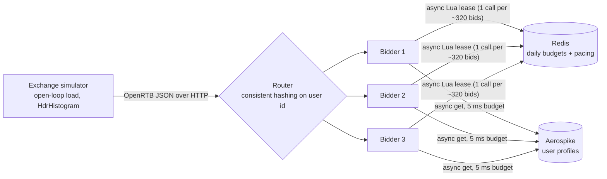

# rtb-platform


A real-time bidding (RTB) platform in Java 21: a low-latency bidder that answers OpenRTB bid requests in about 0.1 ms, enforces campaign budgets across a fleet with Redis-backed leasing, caps ad frequency per user, looks up audience profiles in Aerospike under a strict deadline, and stays correct when its dependencies fail or traffic exceeds capacity. Every claim below comes from a measurement in this repo.

## Highlights

| Area | Result |
|---|---|
| Bidder latency | p50 **0.10 ms** at 5,000 QPS, unchanged after adding targeting, budgets, frequency caps, and async profile lookups |
| Budget leasing | **~1 Redis call per 320 bids** (99.7% fewer than a call per bid), with zero hot-path latency cost |
| Fleet budget correctness | 3 bidder instances, $40.50 leased: **$0.00 overspend**, ledger reconciled to the micro |
| Global pacing | Paced campaigns stopped at **exactly 22.06%** of daily budget (elapsed day + 2% burst), enforced inside one atomic Lua script |
| Frequency caps across a fleet | Round-robin routing: **433 users over cap** (up to 3x). Consistent-hash routing: **0** |
| Database hang (Aerospike frozen) | Circuit breaker skipped **19,000+ lookups**, recovered on the first probe, **0 exchange errors** across 90,000 requests |
| 50% overload | Without shedding: **0 of 45,000** requests answered in time. With deadline-aware shedding: **all 45,000**, p99 **26 ms** |
| Tests | **145 tests**, including Testcontainers suites against real Redis and Aerospike, and chaos tests that freeze and kill them mid-traffic on every CI run |

## Architecture



Inside one bidder, a request flows through layers that each own one concern:

Netty event loop (HTTP, TCP_NODELAY, keep-alive)
-> AdmissionController bounded worker pool, sheds requests that cannot meet the deadline
-> BidPipeline profile lookup with a 5 ms deadline and a circuit breaker
-> TargetingBidEngine pure and synchronous: bitset targeting, frequency caps, pricing, budget reservation


The engine does no I/O at all ("functional core, imperative shell"), so the decision logic is fast and trivially testable, and every timeout, failure, and fallback lives in one thin async layer.

## Key design decisions

**Bitset inverted index for targeting.** Each targeting value (ad size, country, site category, audience segment) maps to a bitset of campaigns. Matching is a bitwise AND across dimensions, 64 campaigns per CPU instruction. The index is immutable after construction, so every event loop thread reads it with no locks.

**Budget leasing instead of a Redis call per bid.** Each bidder leases chunks of a campaign's daily budget from Redis and spends them locally with lock-free compare-and-swap. A refill starts at a low-water mark (20% of a chunk), single-flight per campaign, so it usually lands before the lease runs dry. Redis round trips measured 1.56 ms on average (248 ms worst case) locally, which would have dominated a 0.10 ms bid path.

**Atomic Lua script for leasing and pacing.** Reading the remaining budget, granting a partial amount, and recording the spend run as one atomic Redis script, so concurrent bidders can never drive a budget negative. The same script enforces even pacing (`allowed = total x elapsed share of day + burst`), which makes pacing global across all instances with no extra coordination. Budgets are keyed by UTC date and reset daily without a cron job.

**Consistent hashing for user affinity.** Frequency caps live in each bidder's memory (exact sliding windows, bounded by a Caffeine cache). That is only correct if each user always reaches the same bidder, so the router uses a consistent hash ring with 200 virtual nodes per instance. Adding a fourth instance moves about 25% of users, all onto the new instance; modulo hashing would move about 75%.

**Deadlines everywhere.** Every network call has a timeout matched to how long its result is useful: 5 ms for profile lookups (the Aerospike client gets 7 ms so the pipeline deadline is the single source of truth), and 1 s for Redis refills (instead of Lettuce's 60 s default, which would hold a refill slot for a minute after a Redis blip).

**Circuit breaker.** Lookups are counted over a 1-second window. At 50% failures (minimum 20 calls) the breaker opens and requests skip the lookup entirely; after 2 seconds a single probe tests recovery. The CLOSED path is a lock-free volatile read; recording outcomes takes a lock that is busy about 0.05% of the time at 10,000 calls per second.

**Deadline-aware load shedding.** Bid work runs on a bounded worker pool, not the I/O threads. A request that waited longer than 20 ms in the queue is dropped before any work is done, because its answer would likely miss the exchange deadline. This prevents congestion collapse, where a server spends all its capacity on requests whose callers already gave up.

**Open-loop load testing.** The simulator sends requests on a fixed schedule regardless of how the bidder responds and measures latency from each request's scheduled send time, avoiding coordinated omission. It reports both response time (what the exchange sees) and service time (bidder plus network only), so delays can be attributed to the right side.

## Benchmarks

Environment: a single MacBook Air (Apple Silicon, 16 GB), with the bidder, simulator, Redis, and Aerospike all on one machine and the databases in Docker Desktop. Medians and p99 values are repeatable here; extreme tails (p99.9 and max) are noisy on a shared laptop and are not presented as production numbers.

**Bidder latency at 5,000 QPS** (single instance)

| Configuration | p50 | p90 |
|---|---|---|
| HTTP + JSON only (always no-bid) | 0.10 ms | 0.12 ms |
| + targeting, pricing, Redis budgets, frequency caps | 0.11 ms | 0.15 ms |
| + async Aerospike profile lookups (real network hop) | 0.22 ms | 0.97 ms |

**Overload: 3,000 QPS against ~2,000 QPS of capacity** (1 ms simulated CPU per bid, 2 threads)

| | No shedding | Deadline-aware shedding |
|---|---|---|
| Requests answered within tmax | 0 of 45,000 | 45,000 of 45,000 |
| p50 / p99 | 119 ms / 585 ms | 20.8 ms / 26.3 ms |
| Admitted throughput | n/a | 1,937/s (capacity 2,000/s) |
| Shed | n/a | 35% (overload was 33%) |

**Budget reconciliation across 3 instances** (20 s at 3,000 QPS)

| | |
|---|---|
| Leased from Redis | $40.50 (81 chunks of $0.50) |
| Reserved by bids | $28.45 |
| Stranded in local leases | $12.05 (theoretical bound $18.00) |
| Overspend | **$0.00** |

## Resilience, verified in CI

These run on every push against real containers, using Testcontainers to freeze (`docker pause`) or kill (`docker stop`) a dependency mid-traffic:

| Test | Failure injected | Asserted |
|---|---|---|
| `AerospikeHangChaosTest` | Aerospike frozen | Every request answered, latency under 100 ms, breaker opens, audience bids resume after recovery |
| `AerospikeOutageChaosTest` | Aerospike killed | Every request answered and bid, breaker opens |
| `RedisPauseChaosTest` | Redis frozen | Bidding continues from local leases, stops exactly at the lease boundary (no overspend), resumes after recovery |

## Modules
common/ OpenRTB models, JSON codec, money (micros), consistent hash ring
exchange-simulator/ open-loop load driver, traffic generator (Zipf users), routing, frequency audit
bidder/ Netty server, targeting, pricing, budgets, frequency caps, profiles, resilience
scripts/ start/stop a bidder fleet, reconcile fleet spend against Redis
Tech: Java 21, Netty 4.1, Jackson, Lettuce + Redis 7.4, Aerospike CE 8.1 + Java client, Caffeine, HdrHistogram, JUnit 5, Testcontainers, Docker Compose, GitHub Actions.

## Running it

Prerequisites: Java 21, Maven 3.9+, Docker.

```bash
docker compose up -d                 # Redis and Aerospike
mvn clean verify                     # build and run all 145 tests

# load 100,000 synthetic user profiles into Aerospike
java -cp bidder/target/bidder-0.1.0-SNAPSHOT.jar com.sakshichavan.rtb.bidder.profile.ProfileSeeder

# start a bidder
REDIS_URI=redis://localhost:6379 PROFILE_STORE=aerospike java -jar bidder/target/bidder-0.1.0-SNAPSHOT.jar

# in another terminal: 5,000 QPS for 10 seconds
java -jar exchange-simulator/target/exchange-simulator-0.1.0-SNAPSHOT.jar run --qps 5000 --duration 10
curl -s http://127.0.0.1:8080/stats
```

Fleet of three with consistent-hash routing, a frequency audit, and budget reconciliation:

```bash
scripts/start-bidders.sh 3
java -jar exchange-simulator/target/exchange-simulator-0.1.0-SNAPSHOT.jar run \
  --targets http://127.0.0.1:8081/bid,http://127.0.0.1:8082/bid,http://127.0.0.1:8083/bid \
  --routing user-hash --qps 3000 --duration 20 \
  --caps c-brand-awareness=3,c-news-global=4,c-sports-us=5
python3 scripts/reconcile.py
scripts/stop-bidders.sh
```

## Configuration

| Variable | Default | Purpose |
|---|---|---|
| `BIDDER_PORT` | 8080 | HTTP port |
| `REDIS_URI` | unset | Shared budgets in Redis; unset means in-memory (single instance only) |
| `PROFILE_STORE` | `synthetic` | `aerospike` for real profile lookups |
| `PROFILE_TIMEOUT_MS` | 5 | Profile lookup deadline |
| `PACING` / `PACING_BURST` | `even` / 0.02 | Budget pacing mode and how far ahead of schedule spend may run |
| `LEASE_CHUNK_USD` | 0.50 | Budget leased per Redis call |
| `BID_SHADING_FACTOR` | 0.5 | First-price shading (1.0 = bid full value) |
| `SHEDDING` | `on` | Deadline-aware load shedding |
| `WORKER_THREADS` / `MAX_QUEUE_DELAY_MS` | cores / 20 | Worker pool size and the queue wait after which a request is dropped |
| `CAMPAIGNS_FILE` | bundled | Path to a campaign JSON file |

## Known limitations and trade-offs

- **Budgets are reserved at bid time and not yet released on loss**, so spend is counted as if every bid wins. This can never overspend, but it underspends. Win and loss notifications (next phase) will release losing reservations.
- **Leasing strands some budget** in each instance's local lease, bounded by about 1.2 chunks per campaign per instance. Adaptive chunk sizing based on spend rate, and returning leases on shutdown, would reduce it.
- **Under sustained overload the FIFO queue settles at the 20 ms limit**, so admitted requests wait about 20 ms. Adaptive LIFO with a CoDel-style target would serve most admitted requests in about 1 ms.
- **HTTP pipelining is not supported**: async responses on one connection could complete out of order. Exchanges and the simulator use connection pools with one request in flight per connection.
- **All benchmarks ran on one laptop.** Dedicated machines with pinned CPUs are needed for trustworthy tail latency, which is planned.

## Roadmap

- Kafka and Flink event pipeline: impressions, clicks, and win/loss notifications with idempotent dedup
- Exactly-once billing ledger in Postgres, with reconciliation
- In-process CTR model (ONNX) within a strict latency budget
- Campaign management service and dashboard
- Kubernetes, Helm, and Terraform deployment
- Prometheus, Grafana, and OpenTelemetry tracing
- Load and chaos testing on dedicated hardware, flame graphs, and a CI performance regression gate
